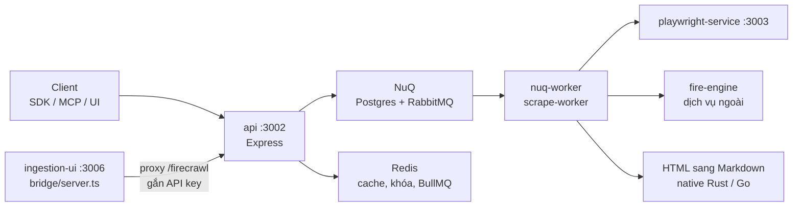
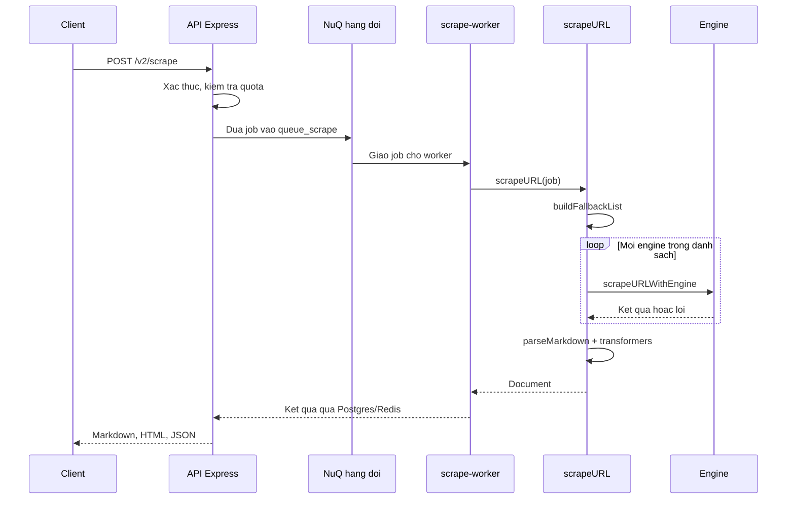
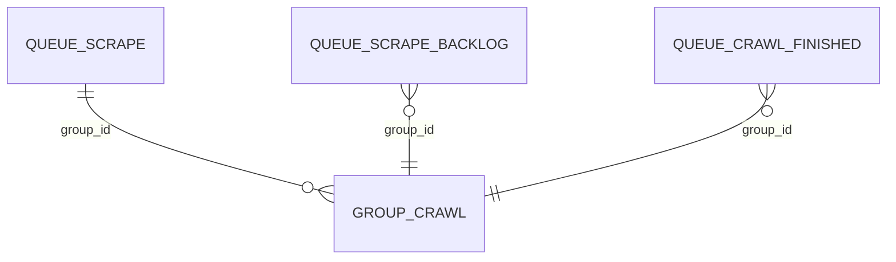
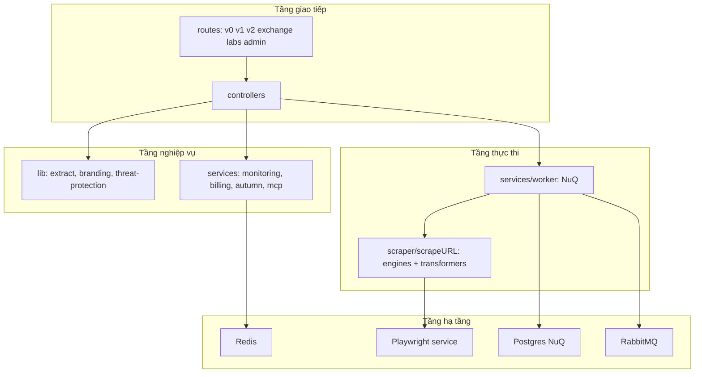
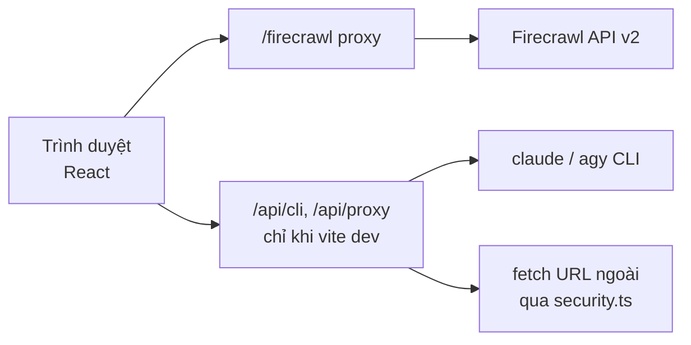

# Tổng quan Firecrawl (bản fork Dương Sinh)

> Tài liệu này mô tả mã nguồn tại commit `96a8e0ae3d` (2026-09-26).
> Mọi số dòng trong tài liệu đếm bằng script (đếm ký tự xuống dòng, không tính `node_modules`, `dist`, `target`); bảng "Bản đồ module" và bảng route được sinh tự động từ mã, không chép tay.
> Đọc kèm: [`PROGRESS.md`](./PROGRESS.md) (danh sách tính năng và tiến độ), [`LICH-SU-TUONG-TAC.md`](./LICH-SU-TUONG-TAC.md) (nhật ký làm việc), [`../CLAUDE.md`](../CLAUDE.md) (luật làm việc cho agent).

---

# Phần A — Chức năng

## Firecrawl là gì

Firecrawl là **một API biến website thành dữ liệu sạch cho AI**. Đưa vào một địa chỉ URL, Firecrawl trả về nội dung dạng Markdown, HTML, ảnh chụp màn hình hoặc dữ liệu có cấu trúc (JSON) mà mô hình ngôn ngữ đọc được ngay. Nó gánh phần việc khó: chạy trình duyệt thật cho các trang cần JavaScript, lách các trang chặn bot, đọc PDF/DOCX, bò qua cả website, và xếp hàng hàng nghìn tác vụ song song.

Repo này là **monorepo** mã nguồn mở của Firecrawl, kèm các phần **bổ sung riêng của bản fork Dương Sinh**: một giao diện web "Ingestion UI" để quét cả cây tài liệu một website, trích xuất bằng AI và xuất ra thư mục Obsidian/Markdown.

## Phục vụ ai

| Người dùng | Cách dùng |
|---|---|
| Lập trình viên xây ứng dụng AI | Gọi API (hoặc SDK 9 ngôn ngữ) để lấy dữ liệu web |
| Người dùng agent (Claude, v.v.) | Qua MCP server và skill để agent tự cào web |
| Đội tự vận hành (self-host) | Chạy cả hệ thống bằng `docker compose` |
| Chủ fork Dương Sinh | Dùng Ingestion UI để gom tài liệu website vào kho tri thức |

## Các mảng chức năng lớn

| Mảng | Làm gì (một dòng) |
|---|---|
| **Scrape** | Lấy nội dung một URL ở nhiều định dạng; tự thử lần lượt nhiều "engine" cho tới khi thành công |
| **Crawl / Batch / Map** | Bò cả website theo link; cào hàng loạt danh sách URL; lập bản đồ link của một site |
| **Search** | Tìm kiếm web rồi tuỳ chọn cào luôn kết quả |
| **Extract** | Dùng LLM rút dữ liệu có cấu trúc theo schema hoặc prompt từ một hay nhiều trang |
| **Agent / Browser / Interact** | Agent tự duyệt web; phiên trình duyệt để click, gõ, chạy thao tác trên trang |
| **Monitor** | Theo dõi trang thay đổi theo lịch, báo qua email/Slack |
| **Xác thực, thanh toán, giới hạn** | API key, tín dụng (credit), giới hạn tốc độ và đồng thời |
| **Bảo mật doanh nghiệp** | Chặn danh mục URL nguy hiểm (threat protection), đẩy log ra SIEM |
| **Branding, llms.txt, deep research** | Rút nhận diện thương hiệu; sinh `llms.txt`; nghiên cứu sâu nhiều bước |
| **SDK và tích hợp** | SDK JS, Python, Go, Java, Rust, Ruby, PHP, Elixir, .NET; MCP, Slack |
| **Ingestion UI (fork)** | Giao diện React quét cây tài liệu, chạy hàng loạt, xuất Obsidian |

## Quy mô

Khoảng **251.355 dòng mã** (không tính test) trong 25 khối thư mục mã nguồn, xem bảng phía dưới. Riêng test end-to-end của API (`apps/api/src/__tests__`) thêm 39.848 dòng / 119 file.

---

# Phần B — Kỹ thuật

## 1. Ngăn xếp công nghệ

| Lớp | Công nghệ | Nguồn xác nhận |
|---|---|---|
| API và worker | Node.js + TypeScript, Express, `express-ws` (WebSocket), `pnpm` | `apps/api/package.json`, `apps/api/src/index.ts` |
| Biên dịch/chạy | `tsc` (compiler `typescript-7`), `tsx` cho dev, `vitest` cho test | `apps/api/package.json` |
| Hàng đợi chính "NuQ" | PostgreSQL (schema `nuq`) + RabbitMQ (`amqplib`); có backend thay thế FoundationDB (`NUQ_BACKEND=fdb`) | `apps/api/src/services/worker/nuq.ts`, `apps/nuq-postgres/nuq.sql`, `SELF_HOST.md` |
| Hàng đợi phụ | BullMQ + Redis (queue llms.txt, deep research, billing, precrawl), giao diện bull-board | `apps/api/src/index.ts` |
| Cache/khoá | Redis (`redlock` cho khoá phân tán) | `apps/api/src/services/redis.ts`, `redlock.ts` |
| Trình duyệt | Vi dịch vụ Playwright/Chromium riêng (cổng mặc định 3003) | `apps/playwright-service-ts/api.ts` |
| Chuyển HTML sang Markdown | Thư viện native Rust (`apps/api/native`) và dịch vụ Go (`/convert`) | `apps/api/native/src/html.rs`, `apps/go-html-to-md-service/handler.go` |
| Quan sát | OpenTelemetry (`otel.ts`), logger winston, PostHog | `apps/api/src/otel.ts`, `services/posthog.ts` |
| UI fork | React + Vite + Tailwind + vitest (jsdom); server sản xuất là `bridge/server.ts` | `apps/ui/ingestion-ui/package.json` |
| Triển khai | Docker Compose; CI trong `.github/workflows/` | `docker-compose.yaml` |

Phiên bản chi tiết của từng thư viện: xem `package.json` của từng app; tài liệu này không chép lại để khỏi lệch.

## 2. Bản đồ module

Bảng sinh bằng script (`Dòng mã` không gồm test; `Dòng test` là các file `*.test.*` và thư mục `__tests__` nằm trong cùng module). Sắp theo kích thước trong nhóm API, rồi tới dịch vụ hạ tầng, UI, SDK.

| Module | Vai trò | Dòng mã | File | Dòng test |
|---|---|---:|---:|---:|
| `apps/api/src/lib` | Thư viện lõi API (extract, threat-protection, branding, ...) | 59.467 | 196 | 16.256 |
| `apps/api/src/services` | Dịch vụ nền (worker, monitoring, autumn, logging, ...) | 33.562 | 109 | 15.026 |
| `apps/api/src/scraper` | Bộ cào (scrapeURL, engines, crawler) | 25.968 | 100 | 10.365 |
| `apps/api/src/controllers` | Controller HTTP v0/v1/v2 | 25.881 | 102 | 5.314 |
| `apps/api/src/search` | Tìm kiếm (search v2) | 2.438 | 14 | 1.121 |
| `apps/api/src/routes` | Định tuyến Express | 2.522 | 9 | 0 |
| `apps/api/src/db` | Kết nối và schema DB | 1.658 | 6 | 59 |
| `apps/api/native` | Thư viện native Rust (html-to-markdown, ...) | 3.397 | 10 | 0 |
| `apps/playwright-service-ts` | Vi dịch vụ Chromium/Playwright | 652 | 2 | 0 |
| `apps/go-html-to-md-service` | Dịch vụ Go chuyển HTML sang Markdown | 657 | 4 | 0 |
| `apps/nuq-postgres` | Postgres cho hàng đợi NuQ | 333 | 1 | 0 |
| `apps/ui/ingestion-ui/src` | Ingestion UI, giao diện React (fork) | 6.031 | 31 | 598 |
| `apps/ui/ingestion-ui/bridge` | Ingestion UI, bridge/server (fork) | 786 | 4 | 245 |
| `apps/js-sdk` | SDK JavaScript | 10.859 | 36 | 5.353 |
| `apps/python-sdk` | SDK Python | 26.267 | 64 | 12.046 |
| `apps/go-sdk` | SDK Go | 4.231 | 14 | 0 |
| `apps/java-sdk` | SDK Java | 7.944 | 93 | 0 |
| `apps/rust-sdk` | SDK Rust | 8.688 | 20 | 0 |
| `apps/ruby-sdk` | SDK Ruby | 3.530 | 35 | 0 |
| `apps/php-sdk` | SDK PHP | 7.467 | 74 | 0 |
| `apps/elixir-sdk` | SDK Elixir | 3.976 | 8 | 0 |
| `apps/dot-net-sdk` | SDK .NET | 4.572 | 41 | 0 |
| `apps/test-site` | Site thử nghiệm | 50 | 4 | 0 |
| `apps/test-suite` | Bộ test cũ | 5 | 2 | 0 |
| `examples` | Ví dụ ứng dụng | 10.414 | 55 | 0 |
| **Tổng (không tính test)** | | **251.355** | | |

Module trung tâm: `apps/api/src/lib` + `services` + `scraper` + `controllers` (khoảng 144.878 dòng, tức 57,6% tổng). Phần fork Dương Sinh (Ingestion UI) chỉ 6.817 dòng.

Thư mục con lớn nhất bên trong `apps/api/src` (dòng mã + test lẫn nhau, đếm bằng `find ... | wc -l` trên `*.ts`):

| Thư mục con | Dòng |
|---|---:|
| `scraper/scrapeURL` | 33.641 |
| `lib/extract` | 27.278 |
| `controllers/v2` | 20.433 |
| `services/monitoring` | 12.350 |
| `services/worker` | 9.524 |
| `services/autumn` | 7.500 |
| `lib/threat-protection` | 7.318 |
| `controllers/v1` | 6.673 |

## 3. Điểm vào — process nào chạy, cổng nào

Compose khai báo các dịch vụ (`docker-compose.yaml`):

| Dịch vụ | Cổng | Ghi chú |
|---|---|---|
| `api` | `3002` (`PORT`/`INTERNAL_PORT`) | Chạy `node dist/src/harness.js --start-docker`; harness khởi động API cùng các worker con |
| `playwright-service` | `3003` (mặc định trong mã) | Chromium; `MAX_CONCURRENT_PAGES` mặc định 10 |
| `redis` | nội bộ | `redis:alpine` |
| `rabbitmq` | nội bộ | `rabbitmq:3-management`; `api` phụ thuộc vào trạng thái healthy |
| `nuq-postgres` | nội bộ | Build từ `apps/nuq-postgres`; bắt buộc healthy trừ khi `NUQ_BACKEND=fdb` |
| `foundationdb`, `foundationdb-init` | nội bộ | Chỉ dùng khi chọn backend FDB |
| `ingestion-ui` | `127.0.0.1:5173` ngoài, `3006` trong container | Profile `ui`, bật bằng `docker compose --profile ui up -d` |

Cổng nội bộ do biến môi trường: `EXTRACT_WORKER_PORT` (mặc định 3004), `WORKER_PORT` (mặc định 3005).

Các process worker (script trong `apps/api/package.json`): `queue-worker`, `nuq-worker`, `nuq-prefetch-worker`, `nuq-reconciler-worker`, `nuq-fdb-worker`, `extract-worker`, `index-worker`, `zdr-worker`, `cclog-worker`. Lệnh `pnpm harness` (file `apps/api/src/harness.ts`) dựng API, worker và hạ tầng để chạy test; `CLAUDE.md` dặn **không** tự `pnpm start`.

## 4. Bảng route (sinh bằng script từ `apps/api/src/routes/*.ts`)

Script dùng regex trên `Router.<method>("path"` nên **có thể đếm thiếu** các route khai báo theo dạng khác; coi đây là cận dưới.

| Router | Số route | Ví dụ tiêu biểu |
|---|---:|---|
| `v0` (cũ) | 8 | `POST /v0/scrape`, `POST /v0/crawl`, `GET /v0/health/liveness` |
| `v1` | 34 | `POST /scrape`, `POST /crawl`, `POST /map`, `POST /extract`, `POST /deep-research`, `POST /llmstxt`, `WS /crawl/:jobId` |
| `v2` (chính) | 69 | `POST /scrape`, `POST /crawl`, `POST /batch/scrape`, `POST /map`, `POST /search`, `POST /extract`, `POST /agent`, `POST /parse`, `POST /monitor`, `POST /scrape/:jobId/interact`, `/team/*`, `/slack/*` |
| `admin` | 1 | `POST /admin/acuc-cache-clear` |
| `labs` | 15 | `POST /search`, `/search/data/*`, `/search/packs`, `/search/configs` |
| `exchange` | 38 | `/discover`, `/skills/resolve`, `/retrieve`, `/publisher/bounties`, `/claims`, `/ingest` |

`v2` là bề mặt API hiện hành; `v1`/`v0` giữ để tương thích. Các nhóm `exchange` và `labs` là hệ sinh thái phụ; ý nghĩa nghiệp vụ chưa đọc sâu, sẽ làm rõ ở tài liệu tính năng riêng.

## 5. Luồng một request tiêu biểu (scrape)

Mô tả theo mã nguồn đã đọc (`apps/api/src/scraper/scrapeURL/README.md`, danh sách `Engine` trong `engines/index.ts`).

Ghi chú: bước chờ kết quả đồng bộ với `POST /v2/scrape` được đơn giản hoá trong sơ đồ; cơ chế thật (job listenable, `listenChannelId` trong `NuQJob`) sẽ mô tả ở tài liệu tính năng Scrape.

### Danh sách engine (kiểu `Engine`)

`exchange`, `fire-engine;chrome-cdp`, `fire-engine(retry);chrome-cdp`, `fire-engine;chrome-cdp;stealth`, `fire-engine(retry);chrome-cdp;stealth`, `fire-engine;tlsclient`, `fire-engine;tlsclient;stealth`, `playwright`, `fetch`, `pdf`, `document`, `image`, `index`, `index;documents`, `wikipedia`, `x-twitter`. Engine nào được đưa vào danh sách thử phụ thuộc cấu hình: `playwright` chỉ có khi cấu hình dịch vụ Playwright; `image` chỉ khi có `FIRE_PDF_BASE_URL`. Bản tự vận hành (self-host) mặc định dùng Playwright kèm fetch dự phòng (theo `SELF_HOST.md`).

### Các transformer sau khi cào

Trong `apps/api/src/scraper/scrapeURL/transformers/`: `llmExtract`, `deterministicJson`, `diff`, `agent`, `audio`, `video`, `product`, `menu`, `query`, `performAttributes`, `redactPII`, `removeBase64Images`, `sendToSearchIndex`.

## 6. Mô hình dữ liệu

Chỉ phần đã xác minh trực tiếp từ `apps/nuq-postgres/nuq.sql`:

- Schema `nuq` gồm 4 bảng: `queue_scrape`, `queue_scrape_backlog`, `queue_crawl_finished`, `group_crawl`.
- Trạng thái job (`NuQJobStatus` trong `nuq.ts`): `queued`, `active`, `completed`, `failed`, `backlog`.
- Mỗi job có `priority`, `ownerId` (chủ/team), `groupId` (nhóm crawl hoặc batch), `data` (JSON), `returnvalue`, `failedReason`.
- Quan hệ khoá ngoại thực sự giữa 4 bảng **chưa kiểm chứng**: sơ đồ ER trên là cách các bảng dùng chung `group_id` theo chỉ mục đã thấy, không phải ràng buộc FK đã xác nhận.
- Cơ sở dữ liệu nghiệp vụ (team, API key, credit) nằm ở DB ngoài mà mã truy cập qua `apps/api/src/db` (`schema/`, `rpc.ts`). Lược đồ đó không có trong repo; chưa đọc.

## 7. Kiến trúc theo tầng

## 8. Phần fork Dương Sinh: Ingestion UI

Nằm gọn trong `apps/ui/ingestion-ui` (theo quy ước fork ở `CLAUDE.md`: giữ thay đổi fork trong thư mục này để đồng bộ upstream không xung đột).

| Khối | File chính | Vai trò |
|---|---|---|
| Khung UI | `src/App.tsx`, `src/components/ingestionV1.tsx` (1.046 dòng), `BatchDocExtractor.tsx` (997), `DocTreeView.tsx`, `AIEngineSettings.tsx`, `PromptBankSelector.tsx` | Giao diện quét cây tài liệu, chạy hàng loạt, chọn engine AI |
| Logic thuần | `src/lib/*.ts` (`docTreeScanner`, `documentProcessor`, `chunkMarkdown`, `markdownFormatter`, `batchExporter`, `batchQueue`, `retry`, `sessionStore`, `firecrawlClient`, `aiEngines`, `pageScraper`, `promptBank`) | Có test `*.test.ts` (vitest) |
| Hook | `src/hooks/useBatchRunner.ts` | Bộ chạy batch tin cậy |
| Bridge | `bridge/security.ts`, `middleware.ts`, `cli.ts`, `server.ts` | Proxy sang API Firecrawl, chạy CLI `claude`/`agy` (chỉ khi dev), kiểm tra bảo mật |

Điểm ràng buộc (từ `CLAUDE.md`): UI chỉ gọi API v2 qua `src/lib/firecrawlClient.ts` và proxy `/firecrawl`; API key gắn ở phía server, **không** nhúng vào bundle; không thêm cờ CLI kiểu `--dangerously-skip-permissions` vì prompt chứa nội dung web đã cào.

## 9. Quy ước mã nguồn

- **Test API ưu tiên end-to-end ("snips")**, đặt ở `apps/api/src/__tests__`; timeout scrape dùng `scrapeTimeout` từ `./lib` (theo `CLAUDE.md`).
- **Cổng điều kiện cho test**: cần fire-engine thì `!process.env.TEST_SUITE_SELF_HOSTED`; cần AI thì `!process.env.TEST_SUITE_SELF_HOSTED || process.env.OPENAI_API_KEY || process.env.OLLAMA_BASE_URL`.
- **Chạy test bằng `pnpm harness jest ...`**, không tự `pnpm start`.
- **`knip` là chốt chặn pre-commit**: không dùng `--no-verify`, phải sửa export/file thừa.
- **Phiên bản API**: controller nằm theo `controllers/v0|v1|v2`; tính năng mới thường chỉ thêm vào `v2`.
- **Kế hoạch triển khai/tài liệu** của fork đặt ở `docs/plans/YYYY-MM-DD-<chủ đề>.md`.
- **UI fork**: trước khi push chạy `pnpm build`, `pnpm test`, `pnpm lint` trong `apps/ui/ingestion-ui`; `vite dev` không kiểm kiểu nên chỉ `pnpm build` bắt lỗi kiểu; mỗi bug fix thêm một test trong `src/lib`.

## 10. Điểm cần lưu ý và hạn chế

### Thiết kế
- `apps/api/src/lib` (59.467 dòng) là "ngăn kéo" lớn nhất nhưng lẫn nhiều mảng không liên quan (extract, branding, threat-protection, browser session...). Khi tìm kiếm nên tìm theo tính năng chứ không theo thư mục.
- Có ít nhất hai đường hàng đợi song song: NuQ (Postgres+RabbitMQ, hoặc FDB) và BullMQ+Redis cho vài tác vụ phụ. Người mới dễ nhầm.
- Nhiều tính năng cốt lõi phụ thuộc dịch vụ ngoài repo (fire-engine, cơ sở dữ liệu tài khoản/billing, `autumn`). Bản self-host không có chúng; xem `SELF_HOST.md`.

### Vận hành
- Xác thực mặc định khi self-host: `USE_DB_AUTHENTICATION=false` (theo `SELF_HOST.md`); bật xác thực cần thêm lược đồ DB không có trong repo.
- Bull board (giao diện quản trị queue) mặc định tắt; chỉ bật với `BULL_AUTH_KEY` mạnh và giới hạn mạng.
- Chạy cả stack bằng `docker compose up -d` (quy ước fork trong `CLAUDE.md`); UI là profile tuỳ chọn `ui`.

### Điều đáng ngờ / chưa kiểm chứng
- `apps/ui/ingestion-ui/README.md` vẫn là **README của template gốc** (nhắc `src/components/ingestion.tsx` và `npm install`), không phản ánh mã fork hiện tại (thư mục `components` có `ingestionV1.tsx`, dự án dùng `pnpm`). Nghi vấn lỗi thời, cần viết lại ở tài liệu tính năng Ingestion UI.
- `apps/api/native/README.md` là README mẫu `@napi-rs/package-template`, không mô tả thư viện thật (`crawler.rs`, `document.rs`, `engpicker.rs`, `html.rs`, `pdf.rs`...).
- `apps/test-suite` chỉ 5 dòng mã: có vẻ là vỏ của bộ test cũ đã di chuyển; chưa xác minh.
- Cách hệ thống chọn giữa chuyển HTML→Markdown bằng Rust native và bằng dịch vụ Go: **chưa xác minh**, sẽ làm rõ ở tài liệu tính năng Scrape.

## 11. Đường dẫn tham chiếu nhanh

| Muốn xem | Mở file |
|---|---|
| Điểm vào API, khởi tạo router | **`apps/api/src/index.ts`** |
| Dựng cả stack cho dev/test | `apps/api/src/harness.ts` |
| Danh sách route v2 | **`apps/api/src/routes/v2.ts`** |
| Cấu hình và biến môi trường | `apps/api/src/config.ts` |
| Pipeline scrape và engine | **`apps/api/src/scraper/scrapeURL/index.ts`**, `engines/index.ts` |
| Hàng đợi NuQ | **`apps/api/src/services/worker/nuq.ts`**, `apps/nuq-postgres/nuq.sql` |
| Worker cào | `apps/api/src/services/worker/scrape-worker.ts` |
| Crawl | `apps/api/src/scraper/WebScraper/crawler.ts`, `services/worker/crawl-logic.ts` |
| Trích xuất bằng LLM | `apps/api/src/lib/extract/`, `scrapeURL/transformers/llmExtract.ts` |
| Monitor thay đổi trang | `apps/api/src/services/monitoring/` |
| Vi dịch vụ Chromium | `apps/playwright-service-ts/api.ts` |
| Dịch vụ Go HTML→MD | `apps/go-html-to-md-service/handler.go` |
| Hướng dẫn self-host | `SELF_HOST.md`, `docker-compose.yaml` |
| Luật làm việc cho agent | `CLAUDE.md`, `AGENTS.md`, `CONTRIBUTING.md` |
| Ingestion UI (fork) | **`apps/ui/ingestion-ui/src/`**, `apps/ui/ingestion-ui/bridge/` |
| Triển khai UI | `docs/deploy-ingestion-ui.md` |
| Kế hoạch đã có | `docs/plans/` (11 file, 2026-09-24 và 2026-09-25) |
